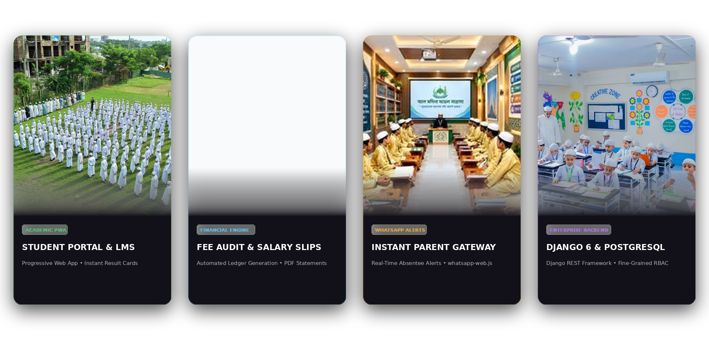

<div align="center">

# 🎓 AMMS — Enterprise Educational Institution Management System
### Full-Stack Madrasah & School ERP with Automated WhatsApp Dispatches Powered by Django 6 & Next.js 16

[](https://almadinamadrasa.pages.dev/)
[](https://www.djangoproject.com/)
[](https://nextjs.org/)
[](https://www.postgresql.org/)
[](https://github.com/pedroslopez/whatsapp-web.js)
[](https://almadinamadrasa.pages.dev/)
[](LICENSE)

<br/>

**[⚡ View Live Production Portal](https://almadinamadrasa.pages.dev/)** &nbsp;•&nbsp; **[📦 GitHub Repository](https://github.com/labibfohayer/AMMS-project)**

<br/>



</div>

---

## 📌 Architectural Overview

**AMMS (Al Modina Model Madrasah Management System)** is an enterprise-grade, full-stack educational institution management platform and Progressive Web Application (PWA). Designed to digitize the entire academic and financial lifecycle of educational institutions, AMMS automates student admissions, exam mark tabulation, fee collection, hostel management, and parent communications.

The architecture comprises a robust **Django 6 REST Framework** backend, an offline-capable **Next.js 16 (App Router)** PWA frontend, and an asynchronous **Node.js WhatsApp microservice** (`whatsapp-web.js`) dispatching real-time notifications directly to guardians.

---

## ⚡ Key Engineering Highlights

1. **Academic LMS & Exam Tabulation Engine:**
   - Multi-branch curriculum support (General Play-Class 6 and Islamic Hifz/Noorani programs).
   - Automated grade-sheet calculation and ReportLab PDF marksheet compilation.

2. **Financial Management & Accounting:**
   - Automated student fee billing, overdue tracking, voucher generation, and staff payroll ledgers.

3. **Guardian WhatsApp Alert Microservice:**
   - Event-driven notifications dispatched via WhatsApp for student absences, fee receipts, and official institutional circulars.

4. **Fine-Grained Role-Based Access Control (RBAC):**
   - JWT-authenticated portals tailored for Super Admins, Branch Directors, Teachers, and Guardians.

---

## 🛠️ Tech Stack & Production Architecture

| Component | Technologies | Purpose |
| :--- | :--- | :--- |
| **Backend Core** | Django 6, Django REST Framework, PostgreSQL | 12 discrete domain applications with RBAC and OpenAPI schemas |
| **Frontend PWA** | Next.js 16, React 19, TanStack Query, Tailwind | Offline-first progressive web application with instant hydration |
| **Messaging Service**| Node.js, Express, whatsapp-web.js | Automated parent notification gateway |
| **Document Engine** | Python ReportLab | Server-side cryptographic vector PDF report generation |
| **Edge CDN** | Cloudflare Pages, Edge Network | Low-latency static frontend delivery |

---

## 🚀 Getting Started & Local Development

```bash
# Clone the repository
git clone https://github.com/labibfohayer/AMMS-project.git
cd AMMS-project

# Backend setup
cd backend
python -m venv venv
source venv/bin/activate
pip install -r requirements.txt
python manage.py migrate
python manage.py runserver

# Frontend setup (in a new terminal)
cd ../frontend
npm install
npm run dev
```

---

## 📄 License
This project is open-source and distributed under the [MIT License](LICENSE).
